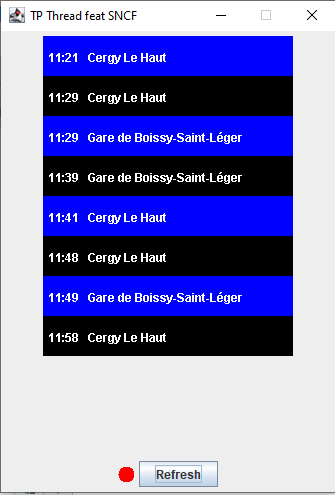
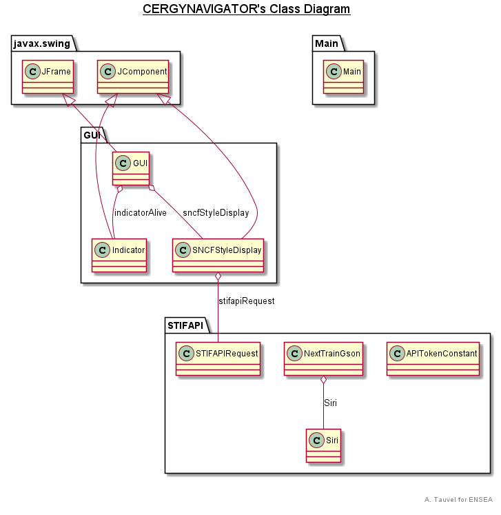

#Exercice on Java OOP for ENSEA graduate sutents

This is a small app developped by myself that dysplays the 
next 8 trains leaving from "Cergy Prefecture" Railroad
Station. The API interrogation has been purposely delayed 
to approximatively 2 secs.

The app is also very importantly blinking an indicator.

When the API is interrogated, the blinking stops... 
It's your goal to fix this very important issue.

You will have to define a Thread for the interrogation, and run
it in parallel.

Here's the UML diagram of the App.

